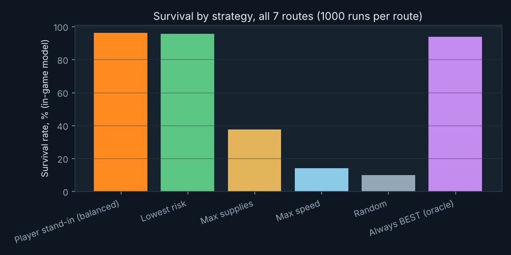
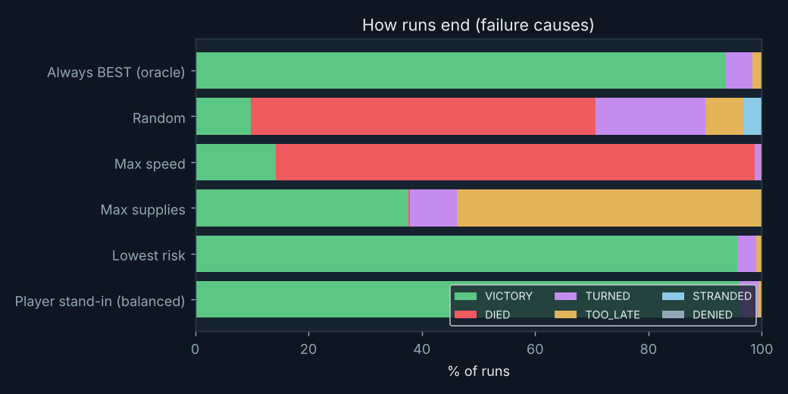
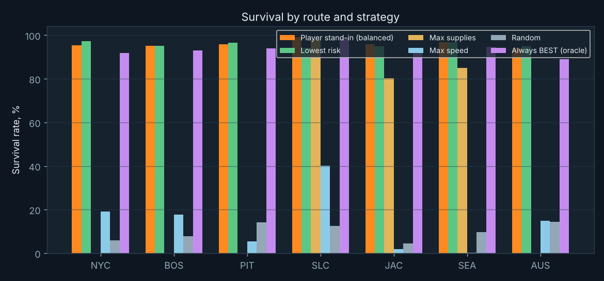
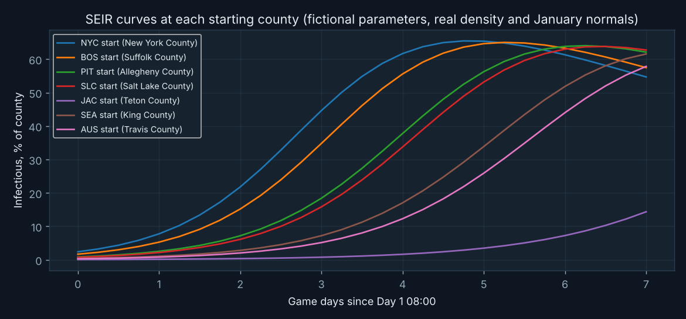

# Zombie Escape: Monte Carlo survival report

> These numbers are probabilities **inside the game's fictional model**. They are not real-world survival odds. Real data (Census population and land area, NOAA January normals, OSRM road distances, CDC SVI 2022) sets the places, densities, temperatures and distances; every coefficient that turns those into risk is invented for the game (see docs/MATH.md).

Runs: 1000 per route per strategy, seeds 1-1000. Every strategy uses the same seeds, so each kind of random event (injury, infection, road accident, town fuel, mini games, rolls) draws from the same random-number stream for every strategy (matched streams). Mini games are simulated with fixed win chances {'HARD': 0.35, 'NORMAL': 0.6, 'EASY': 0.85}.

## Survival by strategy (all 7 routes)

| Strategy | Survival | Avg days used | Avg health (survivors) | Avg food | Avg water | Avg fuel | Infected at least once | Died | Turned | Too late | Stranded | Denied |
|---|---|---|---|---|---|---|---|---|---|---|---|---|
| Player stand-in (balanced) | 96.0% | 6.46 | 93 | 67 | 75 | 18.1 | 37.6% | 0.0% | 3.4% | 0.6% | 0.0% | 0.0% |
| Lowest risk | 95.7% | 6.47 | 90 | 41 | 62 | 17.6 | 31.9% | 0.0% | 3.3% | 1.0% | 0.0% | 0.0% |
| Max supplies | 37.6% | 6.51 | 85 | 77 | 77 | 18.7 | 74.1% | 0.2% | 8.3% | 53.8% | 0.0% | 0.0% |
| Max speed | 14.2% | 5.09 | 21 | 15 | 7 | 12.6 | 21.4% | 84.5% | 1.2% | 0.1% | 0.0% | 0.0% |
| Random | 9.8% | 4.50 | 36 | 34 | 30 | 13.3 | 51.9% | 60.8% | 19.3% | 6.7% | 3.3% | 0.0% |
| Always BEST (oracle) | 93.6% | 6.44 | 95 | 74 | 76 | 17.7 | 46.0% | 0.0% | 4.7% | 1.7% | 0.0% | 0.0% |

## Survival by route

| Strategy | NYC | BOS | PIT | SLC | JAC | SEA | AUS |
|---|---|---|---|---|---|---|---|
| Player stand-in (balanced) | 95% | 95% | 96% | 99% | 96% | 97% | 94% |
| Lowest risk | 97% | 95% | 96% | 94% | 95% | 97% | 95% |
| Max supplies | 0% | 0% | 0% | 98% | 80% | 85% | 0% |
| Max speed | 19% | 18% | 6% | 40% | 2% | 0% | 15% |
| Random | 6% | 8% | 14% | 12% | 4% | 10% | 14% |
| Always BEST (oracle) | 92% | 93% | 94% | 99% | 94% | 95% | 89% |

## Decisions with the biggest impact

From the random strategy (every option gets picked many times): survival rate of runs that picked each option. 'Spread' is the gap between the best and worst option in that scene. This is association inside the model, not proof that one choice alone caused the outcome.

| Scene | Spread | Options (rating: survival if picked) |
|---|---|---|
| PIT-07N | 100% | A WORST: 61%; B OKAY: 0%; C RISKY: 94%; D BEST: 100%; E BEST: 92% |
| AUS-07N | 98% | A OKAY: 97%; B WORST: 0%; C RISKY: 98%; D BEST: 98%; E BEST: 93% |
| NYC-07N | 98% | A RISKY: 0%; B OKAY: 0%; C BEST: 98%; D WORST: 0%; E BEST: 93% |
| SLC-07N | 97% | A BEST: 97%; B OKAY: 0%; C WORST: 82%; D RISKY: 95%; E BEST: 83% |
| BOS-06N | 51% | A OKAY: 58%; B RISKY: 32%; C WORST: 24%; D BEST: 76%; F RISKY: 100%; R OKAY: 56% |
| SEA-06N | 41% | A OKAY: 70%; B RISKY: 51%; C WORST: 29%; D BEST: 73%; F BEST: 100%; R OKAY: 52% |
| SEA-07M | 40% | A WORST: 42%; B OKAY: 71%; C RISKY: 83%; D BEST: 74% |
| AUS-05N | 35% | A RISKY: 26%; B OKAY: 52%; C WORST: 22%; D BEST: 41%; F BEST: 38%; R OKAY: 16% |
| AUS-07M | 35% | A BEST: 73%; B RISKY: 49%; C OKAY: 65%; D WORST: 38%; E BEST: 90% |
| AUS-06N | 34% | A OKAY: 59%; B WORST: 25%; C BEST: 58%; D RISKY: 47%; F OKAY: 100%; R OKAY: 54% |

## Obvious options (dominance check)

122 of 392 main-scene options are no better than another option in the same scene on every measure (expected injury damage, infection chance, time, food, water, fuel, healing). Most are WORST or RISKY options beaten by the BEST option, which is what the ratings intend. List: reports/dominance.csv. The scenario text was not rewritten.

## SEIR sensitivity (beta and gamma)

Prevalence (infectious share) at game Day 4 evening across all 56 route stops:

| beta | gamma | R0 at reference density | lowest stop | highest stop |
|---|---|---|---|---|
| 1.0 | 0.1 | 10.0 | 0.1% | 10.6% |
| 1.0 | 0.15 | 6.7 | 0.1% | 7.7% |
| 1.0 | 0.2 | 5.0 | 0.0% | 5.6% |
| 1.0 | 0.3 | 3.3 | 0.0% | 2.9% |
| 1.25 | 0.1 | 12.5 | 0.2% | 36.0% |
| 1.25 | 0.15 | 8.3 | 0.1% | 28.5% |
| 1.25 | 0.2 | 6.2 | 0.1% | 22.2% |
| 1.25 | 0.3 | 4.2 | 0.0% | 13.1% |
| 1.5 | 0.1 | 15.0 | 0.5% | 62.8% |
| 1.5 | 0.15 | 10.0 | 0.3% | 54.8% |
| 1.5 | 0.2 | 7.5 | 0.2% | 47.5% |
| 1.5 | 0.3 | 5.0 | 0.1% | 34.3% |
| 1.75 | 0.1 | 17.5 | 1.1% | 72.9% |
| 1.75 | 0.15 | 11.7 | 0.7% | 65.8% |
| 1.75 | 0.2 | 8.8 | 0.5% | 59.8% |
| 1.75 | 0.3 | 5.8 | 0.3% | 49.4% |
| 2.0 | 0.1 | 20.0 | 2.3% | 74.2% |
| 2.0 | 0.15 | 13.3 | 1.6% | 66.9% |
| 2.0 | 0.2 | 10.0 | 1.1% | 60.9% |
| 2.0 | 0.3 | 6.7 | 0.6% | 51.5% |

Survival of the balanced strategy when beta changes (200 runs per route): beta 1.0: 99.2%, beta 1.5: 97.1%, beta 2.0: 93.6%.

R0 values here are properties of the game's invented zombie, not estimates for any real disease.

Generated in 284 s.